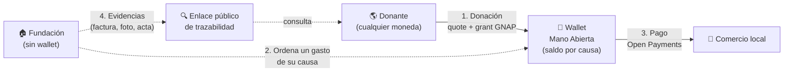
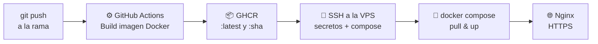

<div align="center">


# Mano Abierta

### *«Cuando ayudar importa, cada segundo cuenta».*

**Mano Abierta, Corazón Abierto. Ayudar debería ser fácil, confiar debería serlo también.**

Plataforma de donaciones para emergencias humanitarias y desastres naturales construida sobre **Open Payments** e **Interledger**. Permite donar desde cualquier país, en cualquier moneda, y seguir cada peso hasta el gasto en que se convirtió.


</div>

---

## El problema

En una emergencia, las donaciones **tardan semanas** en llegar a las familias afectadas, se pierden entre intermediarios y el donante **nunca sabe si su ayuda llegó**.

## La solución

Mano Abierta usa **Open Payments** para que:

- 🌎 **Cualquier persona done desde cualquier país**, en su propia moneda, con la conversión cotizada antes de confirmar.
- 🏦 **La aplicación administre los fondos**: todo el dinero llega a la wallet de Mano Abierta, y cada causa lleva su propio saldo. Las fundaciones no tienen wallet ni manejan dinero directamente.
- ⚡ **Las fundaciones ordenen gastos en minutos** a comercios locales desde la aplicación, y Mano Abierta ejecuta el pago con el saldo de la causa.
- 🔍 **Cada gasto quede rastreado**: el donante recibe un enlace público de trazabilidad y ve en qué categoría, en qué comercio, por qué monto y con qué evidencia se usó su dinero.

## El impacto

> La ayuda llega **en minutos en lugar de semanas**, reactiva la **economía local** del municipio afectado y le muestra al donante **exactamente en qué se convirtió su dinero**.

---

## Pilares de la marca

| | Pilar | Qué significa |
| :---: | --- | --- |
| 🤲 | **Facilidad** | Donar sin barreras: elige una causa, ve el monto en tu moneda y autoriza desde tu billetera. |
| 🔎 | **Transparencia** | Información clara y verificable sobre lo recaudado y lo gastado en cada causa. |
| 💚 | **Impacto** | Los aportes se conectan con necesidades reales y los resultados se comunican con responsabilidad. |

**Valores:** Transparencia · Empatía · Responsabilidad · Agilidad · Integridad · Colaboración

---

## ¿Quién usa Mano Abierta?

| Rol | Quién es | Qué puede hacer |
| --- | --- | --- |
| **Administrador** | Operador de la plataforma | Registrar entidades gubernamentales, suspender cuentas y auditar. |
| **Entidad gubernamental** | Oficina de gestión del riesgo municipal, departamental o nacional | Registrar, activar y suspender fundaciones; verificar evidencias; rechazar gastos. |
| **Fundación** | Organización que atiende la emergencia | Crear causas, ordenar pagos a comercios con el saldo de sus causas y subir evidencias. No tiene wallet propia. |
| **Donante** | Persona o empresa en cualquier país | Ver causas recientes, donar en su moneda y ver en qué se gastó su dinero. |

Esta cadena de confianza (administrador → entidad gubernamental → fundación) garantiza que **solo fundaciones verificadas y activas** puedan recibir donaciones.

---

## Cómo se mueve el dinero



1. **Donación:** se crea un *incoming payment* en la wallet de Mano Abierta, un *quote* en la wallet del donante y un *grant* interactivo. El donante aprueba en su billetera, se ejecuta el *outgoing payment* y el monto se suma al saldo de la causa.
2. **Orden de gasto:** la fundación registra en la aplicación un pago a un comercio o persona, con cargo al saldo de una de sus causas. La fundación nunca recibe ni custodia el dinero.
3. **Pago:** Mano Abierta crea el *incoming payment* en la wallet del comercio y paga desde su propia wallet.
4. **Bloqueo:** si un gasto supera el saldo disponible de la causa, se rechaza y queda registrado con su motivo.

El dinero **siempre está en la wallet de la aplicación** hasta que llega al comercio, y lo gastado en una causa **nunca supera** lo recaudado.

---

## Tecnologías

| Capa | Tecnologías |
| --- | --- |
| **Pagos** | [Open Payments](https://openpayments.dev) (`@interledger/open-payments`), Interledger Protocol, GNAP, HTTP Message Signatures (Ed25519), Interledger Test Wallet |
| **Backend** | Node.js 20, Express 4, `node:test` |
| **Frontend web** | React, servida como estáticos por un servidor Node sin dependencias |
| **Móvil** | Flutter / Dart (Android, iOS, web y escritorio) con Material Design |
| **Base de datos** | PostgreSQL 13+ (montos como `BIGINT` + `asset_code`/`asset_scale`, `ENUM`, `CHECK`, `TIMESTAMPTZ`) |
| **Infraestructura** | Docker, Docker Compose, Nginx (proxy reverso con HTTPS), VPS |
| **CI/CD** | GitHub Actions, GitHub Container Registry (GHCR), despliegue por SSH |

---

## Un repositorio, varias ramas independientes

Este repositorio está organizado como un **monorepo por ramas**: **cada rama funciona como un repositorio independiente**, con su propio código, dependencias, `README.md`, `Dockerfile`, `docker-compose.yml` y pipeline de CI/CD. Las ramas **no se fusionan entre sí**.

| Rama | Responsabilidad | Stack |
| --- | --- | --- |
| [`main`](../../tree/main) | Documentación del proyecto: requisitos, lógica de negocio, branding, diagramas y base de datos. | Markdown, SQL |
| [`backend`](../../tree/backend) | API REST que integra Open Payments, firma las peticiones y es el **único componente con acceso a secretos**. | Node.js · Express · Open Payments |
| [`frontend`](../../tree/frontend) | Aplicación web para donantes, fundaciones y entidades. | React · Node.js |
| [`mobile`](../../tree/mobile) | App móvil con el mismo flujo, pensada para donar desde el celular. | Flutter · Dart |

Para trabajar en una capa, cambia a su rama:

```bash
git clone https://github.com/daniquinto/deploy-con-suero.git
cd deploy-con-suero
git switch backend   # o frontend, o mobile
```

Las capas de interfaz (`frontend` y `mobile`) **nunca ven llaves privadas ni tokens**: consumen la API del `backend`.

---

## Despliegue en VPS con CI/CD

Todo el proyecto está **desplegado en una VPS** y se actualiza automáticamente con **GitHub Actions**. Cada rama tiene su propio pipeline, así que desplegar una capa nunca afecta a las demás.



1. **Build:** un `push` a la rama dispara el workflow, que construye la imagen Docker con caché de capas.
2. **Publicación:** la imagen se sube a **GitHub Container Registry** etiquetada con `latest` y con el SHA del commit.
3. **Secretos:** el `.env` y la llave privada de Open Payments se materializan desde los secretos del repositorio y se copian a la VPS con permisos restringidos; nunca se hornean en la imagen.
4. **Despliegue:** por SSH se ejecuta `docker compose pull && docker compose up -d`, recreando solo el contenedor de esa capa.
5. **Exposición:** los contenedores escuchan únicamente en `127.0.0.1`; el **Nginx de la VPS** es el único punto de entrada, con HTTPS.

| Rama | Workflow | Contenedor |
| --- | --- | --- |
| `backend` | `.github/workflows/deploy-backend.yml` | `backend` (puerto interno 3000) |
| `frontend` | `.github/workflows/deploy-frontend.yml` | `frontend` (puerto interno 8080) |

---

## Seguridad e integridad

- 🔐 Contraseñas con hash lento y sal; autenticación con tokens con expiración y control de acceso por rol.
- 🗝️ Llave privada y tokens de grant fuera del repositorio y del cliente.
- 🏦 Una sola wallet custodia los fondos: la de la aplicación. Ni fundaciones ni entidades manejan dinero directamente.
- ✍️ Peticiones a Open Payments firmadas con HTTP Message Signatures.
- 💰 Dinero siempre como enteros, nunca como punto flotante.
- 🔁 Operaciones idempotentes: un reintento no crea un segundo pago ni cobra dos veces la misma donación.
- 🧾 Registros financieros inmutables y evidencias con hash SHA-256.
- 🙈 La trazabilidad pública nunca expone datos personales de beneficiarios.

---

## Documentación

| Documento | Contenido |
| --- | --- |
| [`docs/requirements.md`](docs/requirements.md) | Historias de usuario, requisitos funcionales y no funcionales, reglas de negocio e integración con Open Payments. |
| [`docs/logica-negocio.md`](docs/logica-negocio.md) | Reglas de negocio del sistema. |
| [`docs/BRANDING.md`](docs/BRANDING.md) | Identidad de marca: nombre, slogan, valores, personalidad y paleta. |
| [`docs/er-diagram.png`](docs/er-diagram.png) | Diagrama entidad-relación. |
| [`docs/use_cases_diagram.webp`](docs/use_cases_diagram.webp) | Diagrama de casos de uso. |
| [`docs/database/`](docs/database) | Script del esquema y datos de prueba. |

---

## Supuestos del MVP

- Se usa la **Interledger Test Wallet** con dinero de prueba; no se mueve dinero real.
- La verificación de identidad (KYC) la realizan las billeteras de cada usuario.
- Proyecto desarrollado para la **hackathon de Open Payments** (octubre de 2026).

---

<div align="center">

**Mano Abierta convierte la solidaridad en acción y la confianza en transparencia.**

<sub>Mano Abierta · Cuando ayudar importa, cada segundo cuenta.</sub>

</div>
